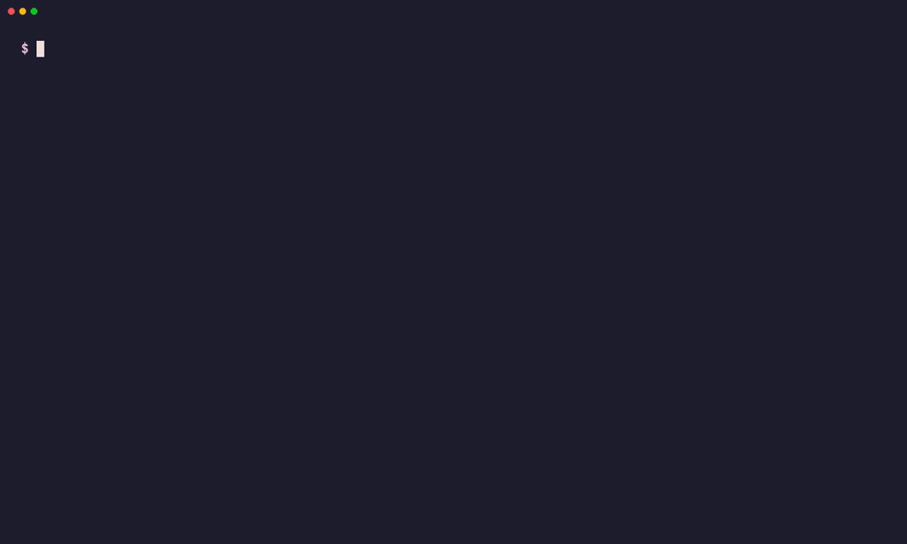
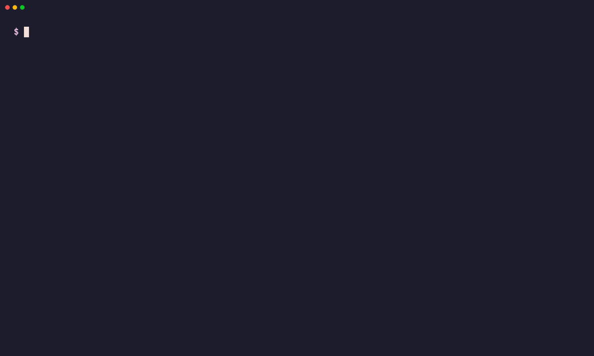

<div align="center">

# linkwarden-cli

**Your [Linkwarden](https://linkwarden.app) bookmarks, from the terminal.**

Save, find, organize, archive and back up links on Linkwarden Cloud or your own instance.<br>
Friendly pickers when you're at the keyboard, clean JSON and fail-fast errors when a script is.

[](https://github.com/CerealKiller97/linkwarden-cli/actions/workflows/test.yml)
[](https://github.com/CerealKiller97/linkwarden-cli/actions/workflows/lint.yml)
[](https://github.com/CerealKiller97/linkwarden-cli/actions/workflows/gosec.yml)
[](https://github.com/CerealKiller97/linkwarden-cli/actions/workflows/govulncheck.yml)
<br>
[](https://github.com/CerealKiller97/linkwarden-cli/releases/latest)
[](go.mod)
[](https://pkg.go.dev/github.com/CerealKiller97/linkwarden-go-sdk)
[](https://goreportcard.com/report/github.com/CerealKiller97/linkwarden-cli)

[Install](#installation) · [Get started](#getting-started) · [Two modes](#two-modes-interactive-and-scripted) · [Examples](#examples) · [Commands](#command-reference) · [Go SDK](#go-sdk)


</div>

## Features

- **Everything Linkwarden does:** links, collections (nested), tags, search, archives, highlights, RSS feeds,
  dashboard, API tokens, import and export.
- **Two modes in one binary:** pickers, readable tables and confirmations in a terminal; JSON, bare IDs and
  fail-fast errors in scripts, cron and CI. [See both](#two-modes-interactive-and-scripted).
- **Bulk operations:** import hundreds of links behind a progress bar, retag, move or delete many links in one call.
- **Archives and backups:** download PDF, screenshot or HTML snapshots, and export your whole library.
- **Easy migration:** bring links over from browser bookmarks, Pocket, Wallabag, Omnivore or another Linkwarden.
- **Shell completion** for bash, zsh and fish, including flag values such as `--format` and `--sort`.
- **A typed Go SDK** behind every command, [`linkwarden-go-sdk`](https://github.com/CerealKiller97/linkwarden-go-sdk),
  that you can use in your own tools.

## Installation

Install script for **macOS and Linux** (x86_64 and ARM64). It sets up tab completions too:

```bash
curl -fsSL https://raw.githubusercontent.com/CerealKiller97/linkwarden-cli/main/install.sh | bash
```

<p align="center">
  
</p>

**Homebrew** (macOS and Linux):

```bash
brew install CerealKiller97/tap/linkwarden-cli
```

**Docker** (linux/amd64 and linux/arm64). Add `-it` for pickers and prompts:

```bash
docker run --rm -e LINKWARDEN_TOKEN -e LINKWARDEN_URL ghcr.io/cerealkiller97/linkwarden-cli links list
```

Image tags are `latest` and each release version without the `v`, for example `1.0.0`.

<details>
<summary><b>Prebuilt binary, from source, or Arch Linux</b></summary>

**Prebuilt binary:** grab the archive for your OS and CPU from
[Releases](https://github.com/CerealKiller97/linkwarden-cli/releases/latest):

```bash
# macOS on Apple Silicon. Swap darwin_arm64 for linux_amd64, linux_arm64 or darwin_amd64.
# VERSION resolves to the latest release; set it yourself (e.g. VERSION=1.0.0) to pin one.
VERSION=$(curl -fsSLI -o /dev/null -w '%{url_effective}' https://github.com/CerealKiller97/linkwarden-cli/releases/latest)
VERSION=${VERSION##*/v}
curl -sSL "https://github.com/CerealKiller97/linkwarden-cli/releases/download/v${VERSION}/linkwarden_${VERSION}_darwin_arm64.tar.gz" | tar -xz
sudo mv "linkwarden_${VERSION}_darwin_arm64/linkwarden" /usr/local/bin/
linkwarden --version
```

**From source** (requires Go 1.27+):

```bash
go install github.com/CerealKiller97/linkwarden-cli/cmd/linkwarden@latest
```

**Arch Linux:** a `linkwarden-cli-bin` AUR package is ready, but the AUR has temporarily closed new account
registrations, so it will be published once they reopen. Until then, use the install script, Docker or a
prebuilt binary.

</details>

## Getting started

### 1. Sign in

```bash
linkwarden init
```

`init` asks for your instance URL (defaults to `https://cloud.linkwarden.app`) and how to sign in:

| Method | What happens |
| --- | --- |
| **Access token** (recommended) | Opens **Settings → Access Tokens** in your browser and asks you to paste the new token. |
| **Email / password** | Signs in once and creates a `linkwarden-cli` access token. Your password is never stored. |
| **Google, Apple, …** | Listed for each single sign-on provider your instance enables. You sign in in the browser, then paste a token. |

The token is checked against your instance, then saved to `$XDG_CONFIG_HOME/linkwarden/config.json`, readable only
by you. Run `init` again any time to switch accounts or instances.

### 2. Save your first link

```bash
linkwarden links create https://go.dev/doc/effective_go --tag golang --tag docs
linkwarden links list
```

### Configuration

Environment variables override the saved config, which suits CI, containers and scripts:

```bash
export LINKWARDEN_TOKEN="eyJhbGciOi..."
export LINKWARDEN_URL="https://links.example.com"   # only for self-hosted instances
```

| Variable | Default | Description |
| --- | --- | --- |
| `LINKWARDEN_TOKEN` | token from `linkwarden init` | API token, sent as a `Bearer` token |
| `LINKWARDEN_URL` | URL from `linkwarden init`, else `https://cloud.linkwarden.app` | Base URL of your instance |
| `NO_COLOR` | unset | Set to any value to turn off colors |
| `XDG_CONFIG_HOME` | `~/.config` | Where `init` saves its config |
| `XDG_STATE_HOME` | `~/.local/state` | Where the CLI keeps a small cache |

> [!TIP]
> Need a token for another machine or a CI job? `linkwarden tokens generate` creates one and offers to add
> `export LINKWARDEN_TOKEN=...` to your shell config (`~/.zshenv`, `~/.bashrc` or `~/.config/fish/config.fish`).

## Two modes: interactive and scripted

The same commands work at your keyboard and inside a script. The CLI checks whether stdin is a terminal and
behaves accordingly, and the global `--non-interactive` flag forces script behavior anywhere.

|  | Interactive (a terminal) | Non-interactive (scripts, cron, CI, pipes) |
| --- | --- | --- |
| No `--id` given | Opens a picker to choose from | Fails fast and names the flag to pass |
| Deleting something | Asks **No / Yes**, with **No** selected | Refuses unless you pass `--yes` |
| List output | Colored table; scrollable when taller than the screen | Plain-text table, or `--json` / `-q` |
| Errors and info | stderr | stderr, so stdout stays clean |

### Interactive

Leave out `--id` on almost any command and pick the item from a list instead: type to filter, ↑/↓ to move,
←/→ to change page, Enter to select and Esc to cancel. The link picker shows each link's URL next to its name
and loads more links as you page or filter.

```bash
linkwarden links get              # pick a link, then print it
linkwarden collections update     # pick a collection, then change it
linkwarden highlights delete      # pick a link, then one of its highlights
linkwarden links import --file reading-list.json   # pick the target collection
```

Lists taller than your terminal open as a scrollable table (↑/↓ or j/k, PgUp/PgDn, g/G, `q` to quit) that stays
on screen when you quit.

Anything that deletes or revokes asks first. **No** is selected, so a stray Enter after a picker cancels.
`collections delete` also tells you how many links go with the collection.

### Non-interactive, for scripts

<p align="center">
  
</p>

Three global flags make the CLI easy to drive from bash:

| Flag | Effect |
| --- | --- |
| `--json` | Prints results as JSON: every field, named as in the API. Lists are arrays, a single `get`, `create` or `update` is an object. |
| `-q`, `--quiet` | Prints only the ID of each result, one per line, and hides info messages. |
| `--non-interactive` | Never prompts, even in a terminal. On by default when stdin isn't a terminal. |

```bash
# Every URL in a collection
linkwarden links list --collection-id 3 --json | jq -r '.[].url'

# Capture the ID of something you create
COL=$(linkwarden collections create --name "Reading List" -q)
linkwarden links create https://12factor.net --collection-id "$COL" -q

# Re-archive every link in a collection
linkwarden links list --collection-id "$COL" -q | xargs -n1 linkwarden links archive --id
```

Without a terminal, a missing ID or an unconfirmed delete is an error, not a prompt that hangs your job:

```console
$ linkwarden collections get < /dev/null
ERR resolve collection ID: no --id given and no interactive terminal available; pass --id explicitly for non-interactive use

$ linkwarden --non-interactive links delete --id 412
ERR this can't be undone and needs confirmation, but there's no interactive terminal: pass --yes (-y) to go ahead
```

> [!IMPORTANT]
> In scripts, always pass IDs explicitly and add `--yes` to deletes you mean to run. The exit code is non-zero on
> any failure, including a `links import` where only some links failed, so `set -e` works as you'd expect.

`--json` and `-q` can't be combined. Commands with nothing to print, such as `delete`, print nothing either way;
check the exit code.

<details>
<summary><b>A complete script: export a collection to CSV</b></summary>

```bash
#!/usr/bin/env bash
# Usage: ./export-csv.sh <collection-id> [output.csv]
set -euo pipefail

collection_id="${1:?usage: $0 <collection-id> [output.csv]}"
output="${2:-links.csv}"

{
  echo '"id","name","url","tags"'
  linkwarden --non-interactive links list --collection-id "$collection_id" --json \
    | jq -r '.[] | [.id, .name, .url, ([.tags[].name] | join(" "))] | @csv'
} > "$output"

echo "Wrote $(( $(wc -l < "$output") - 1 )) links to $output" >&2
```

</details>

More ready-to-run scripts (CSV export, import with a failure report for cron, re-archiving a collection) are in
[`examples/`](examples/README.md).

## Examples

### Organize with collections

<p align="center">
  
</p>

```bash
# Create one, and nest another inside it
linkwarden collections create --name "Rust" --description "The book, std and crates" --color "#f74c00"
linkwarden collections create --name "Async" --parent-id 5 --icon "cube"

# Change one: name it with --id, or leave --id out to pick it
linkwarden collections update --id 6 --name "Async Rust"
linkwarden collections update --public          # picker, then make it public

linkwarden collections list
linkwarden collections get --id 5 --json | jq .name

# Delete: asks first and says how many links go with it; --yes skips that
linkwarden collections delete --id 5
```

New collections go under **Unorganized** unless you pass `--parent-id`. The default color is `#00bba7`.

### Save, find and tidy up links

<p align="center">
  
</p>

```bash
# Save: the name comes from the page's title unless you pass --name
linkwarden links create https://doc.rust-lang.org/book/ --collection-id 2 --tag rust --tag books

# List, filter and search
linkwarden links list --collection-id 2
linkwarden links list --tag-id 4 --pinned-only
linkwarden search --query kubernetes --sort newest

# Many at once: add tags, move, or replace tags with --remove-previous-tags
linkwarden links bulk-update --ids 6,7 --tag weekend
linkwarden links bulk-update --ids 412,418,421 --collection-id 7 --tag reading --remove-previous-tags

# One at a time, by ID or through the picker
linkwarden links update --name "Kubernetes: the overview"
linkwarden links delete --id 17
linkwarden links bulk-delete --ids 301,302 --yes
```

Tags are created as you use them. To manage them directly:

```bash
linkwarden tags create --label golang --label k8s --label architecture
linkwarden tags update --name kubernetes   # picker, then rename
linkwarden tags bulk-delete --ids 14,15,22
```

`--ids` takes a comma-separated list, repeated flags, or both.

### Bulk-import links from a JSON file

<p align="center">
  
</p>

```jsonc
// reading-list.json
[
  { "url": "https://go.dev/doc/effective_go", "title": "Effective Go" },
  { "url": "https://12factor.net", "title": "The Twelve-Factor App" }
]
```

```bash
linkwarden links import --file reading-list.json                    # pick the collection
linkwarden links import --file reading-list.json --collection-id 3  # or name it, for scripts
```

Links already in the collection, and URLs repeated in the file, are skipped. URLs are compared ignoring case in
the scheme and host and any trailing `/`.

### Migrate from your browser, Pocket or Wallabag

```bash
linkwarden migrations import --file bookmarks.html --format html      # Chrome, Firefox, Safari…
linkwarden migrations import --file pocket.json --format pocket
linkwarden migrations import --file wallabag.json --format wallabag
```

`--format` accepts `linkwarden`, `html`, `wallabag`, `omnivore` and `pocket`.

### Back up every night with cron

```cron
# crontab -e: export the whole library at 03:00
0 3 * * * LINKWARDEN_TOKEN=eyJhbGciOi... /usr/local/bin/linkwarden --non-interactive migrations export --output "$HOME/backups/linkwarden-$(date +\%F).json"
```

Restore into another instance with the same file:

```bash
LINKWARDEN_URL=https://new.example.com linkwarden migrations import --file linkwarden-2026-10-06.json --format linkwarden
```

### Find an article and save it as a PDF

```bash
linkwarden search --query "kubernetes operators"
linkwarden archives get --link-id 418 --format pdf --output k8s-patterns.pdf
```

| `--format` | Archive |
| --- | --- |
| `png` | Screenshot (the default) |
| `jpeg` | Screenshot as JPEG |
| `pdf` | PDF |
| `html` | Single-file HTML page |
| `readable` | Readability article text as JSON |

Leave out `--output` to only check whether a snapshot exists. Need a fresh one? Run `linkwarden links archive --id 418`.

### Follow a blog with RSS

```bash
linkwarden rss create --name "The Go Blog" --url https://go.dev/blog/feed.atom --collection-name Go
linkwarden rss list
```

New posts land in the `Go` collection on their own.

<details>
<summary><b>Highlights and dashboard layout</b></summary>

**Highlight a passage:**

```bash
linkwarden highlights create --link-id 412 \
  --text "Don't communicate by sharing memory; share memory by communicating." \
  --color yellow --start-offset 1840 --end-offset 1907 --comment "classic"

linkwarden links get-highlights --id 412
```

**Lay out the dashboard** from a JSON file:

```json
[
  { "type": "STATS", "enabled": true, "order": 0 },
  { "type": "RECENT_LINKS", "enabled": true, "order": 1 },
  { "type": "COLLECTION", "collectionId": 7, "enabled": true, "order": 2 }
]
```

```bash
linkwarden dashboard update-v2 --file layout.json
linkwarden dashboard get-v2
```

</details>

## Command reference

Every command and flag is documented in [`docs/cli/`](docs/cli/linkwarden.md), generated from the code.
`linkwarden <command> --help` prints the same thing, with examples.

| Command | What it does |
| --- | --- |
| [`links`](docs/cli/linkwarden_links.md) | Create, import, list, update, archive and delete bookmarks |
| [`collections`](docs/cli/linkwarden_collections.md) | Group links, optionally nested |
| [`tags`](docs/cli/linkwarden_tags.md) | Label links |
| [`search`](docs/cli/linkwarden_search.md) | Search across all your links |
| [`archives`](docs/cli/linkwarden_archives.md) | Download or upload snapshots (PNG, JPEG, PDF, HTML, readable) |
| [`highlights`](docs/cli/linkwarden_highlights.md) | Annotate passages on a link |
| [`rss`](docs/cli/linkwarden_rss.md) | Feed subscriptions into a collection |
| [`migrations`](docs/cli/linkwarden_migrations.md) | Import and export your library |
| [`tokens`](docs/cli/linkwarden_tokens.md) | Manage API tokens |
| [`dashboard`](docs/cli/linkwarden_dashboard.md) | View and configure the dashboard |
| [`config`](docs/cli/linkwarden_config.md) | The instance's public runtime config |
| [`favicon`](docs/cli/linkwarden_favicon.md) | Fetch the favicon for any URL |
| [`init`](docs/cli/linkwarden_init.md) | Guided sign-in |
| [`completion`](docs/cli/linkwarden_completion.md) | Shell completion for bash, zsh and fish |

## Go SDK

Every command goes through [`linkwarden-go-sdk`](https://github.com/CerealKiller97/linkwarden-go-sdk), a typed
client for the Linkwarden API that lives in its own module:

```bash
go get github.com/CerealKiller97/linkwarden-go-sdk
```

```go
client := linkwarden.New(
	"https://cloud.linkwarden.app",
	os.Getenv("LINKWARDEN_TOKEN"),
	linkwarden.WithHTTPClient(&http.Client{Timeout: 15 * time.Second}),
)

col, err := client.Collections.Create(ctx, linkwarden.CreateCollectionRequest{
	Name:  "Reading List",
	Color: "#f59e0b",
})
if err != nil {
	log.Fatal(err)
}

link, err := client.Links.Create(ctx, linkwarden.CreateLinkRequest{
	Name:       "Effective Go",
	URL:        "https://go.dev/doc/effective_go",
	Collection: linkwarden.Collection{ID: col.ID},
	Tags:       []linkwarden.Tag{{Name: "golang"}, {Name: "docs"}},
})
if err != nil {
	log.Fatal(err)
}
fmt.Printf("saved #%d → %s\n", link.ID, link.URL)
```

<details>
<summary><b>More SDK examples</b></summary>

**Search and list**

```go
hits, err := client.Search.Links(ctx, linkwarden.SearchOptions{SearchQueryString: "kubernetes"})

pinned, err := client.Links.List(ctx, linkwarden.ListLinksOptions{
	CollectionID: 7,
	PinnedOnly:   true,
})
```

**Bulk move and retag**

```go
err := client.Links.BulkUpdate(ctx, linkwarden.BulkUpdateLinksRequest{
	Links:              []linkwarden.Link{{ID: 412}, {ID: 418}},
	RemovePreviousTags: true,
	NewData: linkwarden.BulkUpdateLinksNewData{
		CollectionID: 7,
		Tags:         []linkwarden.Tag{{Name: "weekend"}},
	},
})
```

**Download an archived PDF**

```go
pdf, err := client.Archives.Get(ctx, link.ID, linkwarden.ArchiveFormatPDF, false)
if err != nil {
	log.Fatal(err)
}
os.WriteFile("effective-go.pdf", pdf.Data, 0o644)
```

**Back up everything**

```go
data, err := client.Migrations.Export(ctx)
if err != nil {
	log.Fatal(err)
}
os.WriteFile("backup.json", data, 0o600)
```

**Handle API errors**

```go
_, err := client.Links.Get(ctx, 999999)
switch {
case linkwarden.IsNotFound(err):
	fmt.Println("no such link")
case linkwarden.IsConflict(err):
	fmt.Println("already exists")
case err != nil:
	var apiErr *linkwarden.APIError
	if errors.As(err, &apiErr) {
		fmt.Println(apiErr.StatusCode, apiErr.Message)
	}
}
```

| Service | What it covers |
| --- | --- |
| `client.Links` | CRUD, bulk update/delete, archive, highlights |
| `client.Collections` | CRUD, nesting, sharing |
| `client.Tags` | List, bulk create, rename, delete |
| `client.Search` | Full-text link search |
| `client.Archives` | Get and upload PNG / JPEG / PDF / Readability / HTML |
| `client.Migrations` | Export and import (Linkwarden, HTML, Pocket, …) |
| `client.RSS` | Feed subscriptions |
| `client.Highlights` | Create and delete highlights |
| `client.Tokens` | Create, list, revoke API tokens |
| `client.Dashboard` | v1/v2 dashboard data and layout |
| `client.Config` | Public instance configuration |
| `client.Favicon` | Favicon lookup for any URL |

Options: `WithHTTPClient(*http.Client)` for timeouts, proxies or custom transports, and `WithLogger(zerolog.Logger)`
for internal diagnostics (off by default).

</details>

## Development

```bash
git config core.hooksPath .githooks   # once per clone: keeps docs/cli/ in sync on commit
scripts/dev-linkwarden.sh up          # a throwaway Linkwarden in Docker to test against
go test ./...                         # unit tests
golangci-lint run                     # lint (config in .golangci.yml)
go run ./scripts/gendocs              # regenerate docs/cli/ after changing a command or flag
```

CI runs the tests, the `docs/cli/` check, `golangci-lint`, `gosec` and `govulncheck` on pushes to `main` and on pull
requests, plus [ShellCheck](https://www.shellcheck.net) on `examples/`.

The GIFs above are recorded with [VHS](https://github.com/charmbracelet/vhs) against a throwaway, seeded Linkwarden.
After changing a command's output, re-record them with one script (it needs Docker and Go):

```bash
.github/assets/demo/record.sh                    # every demo
.github/assets/demo/record.sh collections links  # only these
```

See [`.github/assets/demo/`](.github/assets/demo/README.md) for how it works and how to write a new tape.

<details>
<summary><b>Releasing</b></summary>

Versions follow [SemVer](https://semver.org), and [CHANGELOG.md](CHANGELOG.md) follows
[Keep a Changelog](https://keepachangelog.com/en/1.1.0/). Both are generated from
[Conventional Commits](https://www.conventionalcommits.org), so write commit messages like `feat(links): …`,
`fix: …` or `feat!: …` for breaking changes.

```bash
scripts/release.sh patch   # 1.4.2 → 1.4.3  bug fixes
scripts/release.sh minor   # 1.4.2 → 1.5.0  new features
scripts/release.sh major   # 1.4.2 → 2.0.0  breaking changes
```

The script shows the next version and a changelog preview, then triggers the
[release workflow](.github/workflows/release.yml), which:

1. Tests the code.
2. Prepends the new version's section to `CHANGELOG.md`, commits it and tags `vX.Y.Z`.
3. Builds Linux and macOS binaries for x86_64 and ARM64 with [GoReleaser](.goreleaser.yaml).
4. Pushes the commit and tag, then publishes a GitHub Release with the changelog section as its notes.
5. Opens a PR against [CerealKiller97/homebrew-tap](https://github.com/CerealKiller97/homebrew-tap). The
   `linkwarden-cli-bin` AUR package is built but not pushed until AUR registrations reopen.
6. Pushes a multi-arch image to `ghcr.io/cerealkiller97/linkwarden-cli`.

Preview the changelog with `scripts/release.sh changelog 1.5.0`, and the binaries, Homebrew cask, AUR PKGBUILD and
Docker images with `goreleaser release --snapshot --clean` (output in `dist/`).

The workflow uses these repository secrets:

| Secret | What it is |
| --- | --- |
| `PACKAGES_GITHUB_TOKEN` | PAT from a repository admin, with write access to `linkwarden-cli` and `homebrew-tap` (fine-grained: Contents and Pull requests read/write). It pushes the release commit and tag to the protected `main` branch, pushes the cask to `homebrew-tap` and opens its PR. |
| `AUR_KEY` | Private SSH key (no passphrase) whose public half is on your [AUR account](https://aur.archlinux.org/account). Not needed until AUR publishing is turned back on. |

</details>

---

<div align="center">

Built with [Cobra](https://github.com/spf13/cobra) · [Bubble Tea](https://github.com/charmbracelet/bubbletea) · [Bubbles](https://github.com/charmbracelet/bubbles) · [Lip Gloss](https://github.com/charmbracelet/lipgloss) · Demos recorded with [VHS](https://github.com/charmbracelet/vhs)

Not affiliated with the Linkwarden project.

</div>
