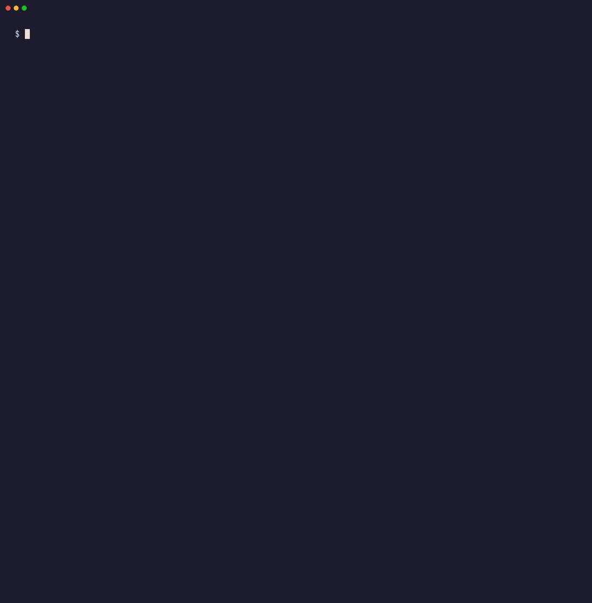

<div align="center">

# 🔗 linkwarden-cli

**Your [Linkwarden](https://linkwarden.app) bookmarks, from the terminal.**

A fast, scriptable CLI and a standalone Go SDK for managing links, collections, tags,
archives, RSS feeds, highlights and backups on Linkwarden Cloud or your own self-hosted instance.

[](https://github.com/CerealKiller97/linkwarden-cli/actions/workflows/test.yml)
[](https://github.com/CerealKiller97/linkwarden-cli/actions/workflows/lint.yml)
[](https://github.com/CerealKiller97/linkwarden-cli/actions/workflows/gosec.yml)
[](https://github.com/CerealKiller97/linkwarden-cli/actions/workflows/govulncheck.yml)
<br>
[](go.mod)
[](https://pkg.go.dev/github.com/CerealKiller97/linkwarden-go-sdk)
[](https://goreportcard.com/report/github.com/CerealKiller97/linkwarden-cli)

[Quick start](#-quick-start) · [Recipes](#-recipes) · [Command reference](#-command-reference) · [Go SDK](#-go-sdk)

</div>

---

## ✨ Highlights

|                          |                                                                                                   |
| ------------------------ | ------------------------------------------------------------------------------------------------- |
| 🧭 **Interactive pickers** | Leave out `--id` and pick the link, collection, tag or feed from a list right in your terminal.     |
| 🤖 **Script-safe**         | `--json` for machine-readable output, `-q` for bare IDs. Without a TTY (cron, CI, pipes) it fails fast instead of hanging on a prompt. |
| 📦 **Bulk operations**     | Import hundreds of links with a progress bar; retag, move or delete many links in one call.       |
| 🗄️ **Archives & backups**  | Download PDF, screenshot or HTML snapshots; export and import your whole library.                 |
| 🔄 **Easy migration**      | Import from browser bookmarks, Pocket, Wallabag, Omnivore or another Linkwarden instance.         |
| 🎨 **Readable output**     | Colorful rounded tables; long ones open as an interactive, scrollable table. Plain text when piped or `NO_COLOR` is set. |
| 🧰 **Go SDK**              | Every command is backed by [`linkwarden-go-sdk`](https://github.com/CerealKiller97/linkwarden-go-sdk), a typed API client you can use in your own code. |

---

## 🚀 Quick start

### 1. Install

**⚡ One-liner** (macOS and Linux, x86_64 and ARM64):

```bash
curl -fsSL https://raw.githubusercontent.com/CerealKiller97/linkwarden-cli/main/install.sh | bash
```



It picks the right build for your OS and CPU, checks it against the release's `checksums.txt`, and
installs `linkwarden` into `/usr/local/bin`, asking for `sudo` when needed. It also installs tab
completions for your shell (`--no-completions` skips them). Pick `~/.local/bin` in its menu, or pass
`--dir`, to install just for you without `sudo`. If that folder isn't on your `PATH`, it offers to add
it. Pass options after `bash -s --`:

```bash
# Pin a version, pick the folder, and don't ask anything (handy in CI and Dockerfiles)
curl -fsSL https://raw.githubusercontent.com/CerealKiller97/linkwarden-cli/main/install.sh | bash -s -- --version 1.0.0 --dir ~/bin --yes
```

Run it with `--help` for every option, or `--uninstall` to remove it again. Prefer to read a script
before you run it? Download it first:

```bash
curl -fsSL https://raw.githubusercontent.com/CerealKiller97/linkwarden-cli/main/install.sh -o install.sh
less install.sh
bash install.sh
```

**🍺 Homebrew** (macOS and Linux):

```bash
brew install CerealKiller97/tap/linkwarden-cli
```

**🐧 Arch Linux** ([AUR](https://aur.archlinux.org/packages/linkwarden-cli-bin)):

```bash
yay -S linkwarden-cli-bin
```

**🪟 Windows** (winget):

```powershell
winget install CerealKiller97.LinkwardenCLI
```

All three install shell completions for bash, zsh and fish where the platform supports them.

**🐳 Docker** (linux/amd64 and linux/arm64):

```bash
docker run --rm -e LINKWARDEN_TOKEN -e LINKWARDEN_URL ghcr.io/cerealkiller97/linkwarden-cli links list
```

Add `-it` for interactive prompts. Tags are `latest` and each release version without the `v`, e.g. `1.0.0`.

**📦 Prebuilt binary:** grab the archive for your OS and CPU (x86_64 or ARM64) from
[Releases](https://github.com/CerealKiller97/linkwarden-cli/releases/latest):

```bash
# macOS on Apple Silicon. Swap darwin_arm64 for linux_amd64, linux_arm64, darwin_amd64…
# VERSION resolves to the latest release; set it yourself (e.g. VERSION=1.0.0) to pin one.
VERSION=$(curl -fsSLI -o /dev/null -w '%{url_effective}' https://github.com/CerealKiller97/linkwarden-cli/releases/latest)
VERSION=${VERSION##*/v}
curl -sSL "https://github.com/CerealKiller97/linkwarden-cli/releases/download/v${VERSION}/linkwarden_${VERSION}_darwin_arm64.tar.gz" | tar -xz
sudo mv "linkwarden_${VERSION}_darwin_arm64/linkwarden" /usr/local/bin/
linkwarden --version
```

**🛠️ From source** (requires **Go 1.27+**):

```bash
git clone https://github.com/CerealKiller97/linkwarden-cli.git
cd linkwarden-cli
go build -o linkwarden .
sudo mv linkwarden /usr/local/bin/
```

Or install straight from the module path. The binary is named `linkwarden-cli` this way:

```bash
go install github.com/CerealKiller97/linkwarden-cli@latest
```

### 2. Authenticate

Run the guided setup:

```bash
linkwarden init
```

After a welcome banner with the Linkwarden logo, it asks for your instance URL (defaults to `https://cloud.linkwarden.app`) and how you'd like to sign in:

- **Access Token (Recommended):** opens **Settings → Access Tokens** in your browser, walks you through
  creating a token, and asks you to paste it.
- **Email / Password:** signs in once, creates a `linkwarden-cli` access token with that session, and
  saves the token. Your password is never stored. Hidden if your instance turned password sign-in off.
- **Sign in with Google / Apple / …:** listed for each single sign-on provider your instance has
  enabled. Sign-in happens in your browser (the CLI can't take part in that OAuth redirect), then you
  create an access token there and paste it back.

The token is checked against your instance, then saved to `$XDG_CONFIG_HOME/linkwarden/config.json`
(readable only by you). Run `linkwarden init` again any time to switch accounts or instances.

Prefer environment variables (CI, scripts, containers)? They override the config file:

```bash
export LINKWARDEN_TOKEN="eyJhbGciOi..."
export LINKWARDEN_URL="https://links.example.com"   # only for self-hosted instances
```

| Variable           | Required | Default                        | Description                                  |
| ------------------ | :------: | ------------------------------ | -------------------------------------------- |
| `LINKWARDEN_TOKEN` |          | token from `linkwarden init`   | API token used as a `Bearer` token           |
| `LINKWARDEN_URL`   |          | URL from `linkwarden init`, else `https://cloud.linkwarden.app` | Base URL of your Linkwarden instance |
| `NO_COLOR`         |          | —                              | Set to any value to disable colored output   |
| `XDG_STATE_HOME`   |          | `~/.local/state`               | Where the CLI keeps its cache (see below)    |
| `XDG_CONFIG_HOME`  |          | `~/.config`                    | Where `init` saves its config (and `tokens generate` finds fish's config) |

> [!NOTE]
> 📁 The CLI follows the [XDG Base Directory spec](https://specifications.freedesktop.org/basedir-spec/latest/)
> on **Linux, macOS and Windows** alike: `init` saves `$XDG_CONFIG_HOME/linkwarden/config.json`, and a small cache lives in `$XDG_STATE_HOME/linkwarden/`.
> If a variable is unset, empty or not an absolute path, the default under your home directory is used
> (`$HOME` on Linux/macOS, `%USERPROFILE%` on Windows, e.g. `C:\Users\you\.local\state\linkwarden`).

> [!TIP]
> Already authenticated? Run `linkwarden tokens generate` to create a new token for another machine or script.
> On macOS and Linux it offers to append `export LINKWARDEN_TOKEN=...` to your shell config
> (`~/.zshenv`, `~/.bashrc` or `~/.config/fish/config.fish`). If you decline, it prints the manual steps.

### 3. Go

```bash
linkwarden links create https://go.dev/doc/effective_go --tag go
```

```console
$ linkwarden links list --collection-id 3
╭─────────────────────────────────────────────────────────────────────────────────────────────╮
│ Links                                                                                       │
├─────┬───────────────────────┬─────────────────────────────────┬──────────────┬──────────────┤
│  ID │ NAME                  │ URL                             │ COLLECTION   │ TAGS         │
├─────┼───────────────────────┼─────────────────────────────────┼──────────────┼──────────────┤
│ 412 │ Effective Go          │ https://go.dev/doc/effective_go │ Go           │ golang, docs │
│ 418 │ Kubernetes Patterns   │ https://k8spatterns.io          │ Infra        │ k8s, books   │
│ 421 │ The Twelve-Factor App │ https://12factor.net            │ Architecture │ design       │
╰─────┴───────────────────────┴─────────────────────────────────┴──────────────┴──────────────╯
```

---

## 🍳 Recipes

Real-world workflows built from the commands below.

### 📥 Bulk-import links from a JSON file

```jsonc
// reading-list.json
[
  { "url": "https://go.dev/doc/effective_go", "title": "Effective Go" },
  { "url": "https://12factor.net",            "title": "The Twelve-Factor App" },
  { "url": "https://k8spatterns.io",          "title": "Kubernetes Patterns" }
]
```

```bash
# Pick the target collection interactively…
linkwarden links import --file reading-list.json

# …or name it up front (handy in scripts)
linkwarden links import --file reading-list.json --collection 3
```

Links already in the target collection are skipped (URLs are compared ignoring case in the scheme and host and any
trailing `/`), as are URLs repeated within the file. The rest are imported behind a progress bar, followed by a
**Total / Success / Already exists / Failed** summary table.

### 🚚 Migrate from Pocket, your browser or Wallabag

```bash
# Browser bookmarks exported as HTML (Chrome, Firefox, Safari…)
linkwarden migrations import --file bookmarks.html --format html

# Pocket export
linkwarden migrations import --file pocket.json --format pocket

# Wallabag export
linkwarden migrations import --file wallabag.json --format wallabag
```

| `--format`   | Source          |
| ------------ | --------------- |
| `linkwarden` | Linkwarden JSON |
| `html`       | Bookmarks HTML  |
| `wallabag`   | Wallabag JSON   |
| `omnivore`   | Omnivore JSON   |
| `pocket`     | Pocket JSON     |

### 💾 Nightly backups with cron

```bash
linkwarden --non-interactive migrations export --output ~/backups/linkwarden-$(date +%F).json
```

```cron
# crontab -e: back up every night at 03:00
0 3 * * * LINKWARDEN_TOKEN=eyJhbGciOi... /usr/local/bin/linkwarden --non-interactive migrations export --output "$HOME/backups/linkwarden-$(date +\%F).json"
```

Restoring into a fresh instance is the same file in reverse:

```bash
LINKWARDEN_URL=https://new.example.com linkwarden migrations import --file linkwarden-2026-10-06.json --format linkwarden
```

### 🏷️ Retag and reorganize in bulk

```bash
# Move three links into "Reading List" (collection 7) and replace their tags
linkwarden links bulk-update \
  --ids 412,418,421 \
  --collection-id 7 \
  --tag reading --tag weekend \
  --remove-previous-tags

# Create several tags at once
linkwarden tags create --label golang --label k8s --label architecture

# Rename a tag (no --id given, so it opens a picker)
linkwarden tags update --name kubernetes

# Clean up (asks before deleting; --yes skips the question)
linkwarden tags bulk-delete --ids 14,15,22
linkwarden links bulk-delete --ids 301,302 --yes
```

### 📄 Find an article and save it as a PDF

```bash
linkwarden search --query "kubernetes operators"
linkwarden archives get --link-id 418 --format pdf --output k8s-patterns.pdf
```

Leave out `--output` to print only the content type and size, which is a quick way to check whether a snapshot exists.

| `--format` | Archive                                      |
| ---------- | -------------------------------------------- |
| `png`      | PNG screenshot (the default for `get`)       |
| `jpeg`     | JPEG screenshot                              |
| `pdf`      | PDF                                          |
| `html`     | Single-file HTML page (Monolith)             |
| `readable` | Readability article text as JSON (get only) |

Shell completion suggests these names, as it does for `migrations import --format` and `search --sort`.

Need a fresh snapshot? Trigger re-archiving first:

```bash
linkwarden links archive --id 418
```

### 📡 Follow a blog with RSS

```bash
linkwarden rss create \
  --name "The Go Blog" \
  --url https://go.dev/blog/feed.atom \
  --collection-name Go

linkwarden rss list
```

New posts show up in the `Go` collection automatically.

### 🗂️ Organize with nested collections

```bash
linkwarden collections create --name "Infra" --color "#6366f1"
linkwarden collections create --name "Kubernetes" --parent-id 9 --icon "cube"
linkwarden collections update --id 9 --public
```

```console
$ linkwarden collections list
╭──────────────────────────────────────────────────────────────────╮
│ Collections                                                      │
├────┬──────────────┬────────────────────────────────────┬─────────┤
│ ID │ NAME         │ DESCRIPTION                        │ COLOR   │
├────┼──────────────┼────────────────────────────────────┼─────────┤
│  3 │ Go           │ Managed by: Linkwarden CLI         │ #00bba7 │
│  7 │ Reading List │ Long-form articles for the weekend │ #f59e0b │
╰────┴──────────────┴────────────────────────────────────┴─────────╯
```

### 🖍️ Highlight passages

```bash
linkwarden highlights create \
  --link-id 412 \
  --text "Don't communicate by sharing memory; share memory by communicating." \
  --color yellow \
  --start-offset 1840 --end-offset 1907 \
  --comment "classic"

linkwarden links get-highlights --id 412
linkwarden highlights delete            # link picker → highlight picker
```

### 📊 Customize the dashboard

```json
[
  { "type": "STATS",        "enabled": true, "order": 0 },
  { "type": "RECENT_LINKS", "enabled": true, "order": 1 },
  { "type": "COLLECTION",   "collectionId": 7, "enabled": true, "order": 2 }
]
```

```bash
linkwarden dashboard update-v2 --file layout.json
linkwarden dashboard get-v2
```

---

## 🤖 Interactive vs. non-interactive

Any command that takes a resource ID opens a **picker** when you leave the ID out and stdin is a terminal.
Type to filter the list, use ↑/↓ to move, ←/→ (or PgUp/PgDn) to change page, Enter to select and Esc to cancel.
The link picker shows each link's shortened URL next to its name (you can filter on either) and loads more
links as you page past the ones loaded so far, or as you filter for one that isn't loaded yet.

List output that's taller than your terminal opens as an interactive table (↑/↓ or j/k, PgUp/PgDn, g/G, `q` to quit),
based on Bubble Tea's [table example](https://github.com/charmbracelet/bubbletea/blob/main/examples/table/main.go).
It renders inline and stays on screen when you quit. Tables that fit on screen, piped output and `--non-interactive`
print the same table as plain text.
When stdin isn't a terminal (scripts, CI, pipes), it **fails fast** and tells you which flag to pass:

```console
$ linkwarden collections get < /dev/null
Error: no --id given and no interactive terminal available; pass --id explicitly for non-interactive use
```

Use the global `--non-interactive` flag to force that behavior even inside a real terminal. It's useful for
testing scripts locally or for CI runners that allocate a pty:

```bash
linkwarden collections get                         # picker (real terminal)
linkwarden collections get --id 42                 # never prompts
linkwarden --non-interactive collections get       # fails fast, even in a terminal
```

### 🧾 JSON and IDs for scripts

Add the global `--json` flag to get results as JSON instead of a table. Field names are the API's own, and you
get every field, not only the columns the table shows. Lists print as an array, a single `get`, `create` or
`update` as an object:

```bash
linkwarden links list --collection-id 3 --json | jq -r '.[] | "\(.id)\t\(.url)"'
linkwarden collections get --id 7 --json | jq .name
```

`-q` / `--quiet` prints only the ID of each result, one per line, and hides info messages, so it pipes
straight into another command:

```bash
# Delete every link that matches a search
linkwarden links list --search "old draft" -q | paste -sd, - | xargs -I{} linkwarden links bulk-delete --ids {} --yes

# Capture the ID of a new collection
COLLECTION=$(linkwarden collections create --name "Reading List" -q)
```

Commands with nothing to list, such as `delete`, print nothing on stdout either way; check the exit code.
`--json` and `--quiet` can't be combined. Errors and info messages always go to stderr, so stdout stays clean.

Ready-to-run scripts built on these flags (CSV export, import with a failure report for cron, and more) are in
[`examples/`](examples/README.md).

### 🛑 Confirming deletes

Commands that delete or revoke something ask **No / Yes** first, with **No** selected, so a stray Enter
(for example right after a picker) cancels. `collections delete` names the collection and how many links go
with it. Pass `--yes` (`-y`) to skip the question.

Without a terminal, or with `--non-interactive`, there's no one to ask, so these commands refuse to run unless
you pass `--yes`:

```console
$ linkwarden links delete --id 412 < /dev/null
Error: this can't be undone and needs confirmation, but there's no interactive terminal: pass --yes (-y) to go ahead
```

This applies to `links delete`, `links bulk-delete`, `links delete-archive`, `collections delete`, `tags delete`,
`tags bulk-delete`, `rss delete`, `highlights delete` and `tokens revoke`.

---

## 📚 Command reference

Run `linkwarden <command> <subcommand> --help` for the full flag list of anything below.
`[--id ID]` means the flag is optional and a picker appears when it's left out.

<details open>
<summary><b><code>links</code></b>: create, list, update and archive bookmarks</summary>

```bash
linkwarden links create         URL [--name NAME] [--description TEXT] [--collection ID] [--tag NAME ...]
linkwarden links import         --file FILE [--collection ID] [--concurrency N]
linkwarden links list           [--collection-id ID] [--tag-id ID] [--pinned-only] [--search QUERY] [--cursor N]
linkwarden links get            [--id ID]
linkwarden links update         [--id ID] [--name NAME] [--url URL] [--description TEXT] [--color HEX] [--icon NAME] [--icon-weight W]
linkwarden links delete         [--id ID] [--yes]
linkwarden links archive        [--id ID]
linkwarden links get-highlights [--id ID]
linkwarden links bulk-update    --ids 1,2,3 [--collection-id ID] [--tag NAME ...] [--remove-previous-tags]
linkwarden links bulk-delete    --ids 1,2,3 [--yes]
linkwarden links delete-archive --ids 1,2,3 [--yes]
```
</details>

<details>
<summary><b><code>collections</code></b>: group links, optionally nested</summary>

```bash
linkwarden collections create [--name NAME] [--description TEXT] [--color HEX] [--icon NAME] [--icon-weight W] [--parent-id ID]
linkwarden collections list
linkwarden collections get    [--id ID]
linkwarden collections update [--id ID] [--name NAME] [--description TEXT] [--color HEX] [--icon NAME] [--parent-id ID] [--public]
linkwarden collections delete [--id ID] [--yes]
```

`create` defaults to color `#00bba7` and description `Managed by: Linkwarden CLI`.
</details>

<details>
<summary><b><code>tags</code></b>: label links</summary>

```bash
linkwarden tags list        [--search QUERY] [--cursor N]
linkwarden tags get         [--id ID]
linkwarden tags create      --label LABEL [--label LABEL ...]
linkwarden tags update      [--id ID] --name NAME
linkwarden tags delete      [--id ID] [--yes]
linkwarden tags bulk-delete --ids 1,2,3 [--yes]
```
</details>

<details>
<summary><b><code>tokens</code></b>: manage API tokens</summary>

```bash
linkwarden tokens generate   # prompts for a name and expiry (7/30/60/90 days or never)
linkwarden tokens list
linkwarden tokens revoke     [--yes]   # picker
```
</details>

<details>
<summary><b><code>rss</code></b>: feed subscriptions into a collection</summary>

```bash
linkwarden rss list
linkwarden rss create --name NAME --url FEED_URL [--collection-id ID | --collection-name NAME]
linkwarden rss delete [--id ID] [--yes]
```
</details>

<details>
<summary><b><code>highlights</code></b>: annotate passages on a link</summary>

```bash
linkwarden highlights create --link-id ID --text TEXT --color COLOR --start-offset N --end-offset N [--comment TEXT]
linkwarden highlights delete [--id ID] [--link-id ID] [--yes]
```

The API has no list-all endpoint, so `delete` without `--id` asks for a link first, then a highlight on it.
</details>

<details>
<summary><b><code>archives</code></b>: download or upload snapshots</summary>

```bash
linkwarden archives get               --link-id ID [--format png|jpeg|pdf|html|readable] [--output PATH] [--preview]
linkwarden archives upload            --link-id ID --file PATH --format png|jpeg|pdf|html [--preview]
linkwarden archives upload-standalone --url URL --file PATH --format png|jpeg|pdf|html [--preview]
```

`upload-standalone` creates a new link from a local file, for example a page you saved yourself.
</details>

<details>
<summary><b><code>migrations</code></b>: import and export your library</summary>

```bash
linkwarden migrations export [--output PATH]   # default: ./linkwarden-export-<timestamp>.json
linkwarden migrations import --file PATH --format linkwarden|html|wallabag|omnivore|pocket
```
</details>

<details>
<summary><b><code>search</code> · <code>dashboard</code> · <code>config</code> · <code>favicon</code> · <code>completion</code></b></summary>

```bash
linkwarden search --query TEXT [--sort newest|oldest|name-asc|name-desc|description-asc|description-desc] [--cursor N]

linkwarden dashboard get                    # v1 dashboard data
linkwarden dashboard get-v2                 # v2 dashboard data
linkwarden dashboard update-v2 --file layout.json

linkwarden config get                       # instance's public runtime config

linkwarden favicon get --url https://go.dev [--output go.ico]

linkwarden completion zsh > "${fpath[1]}/_linkwarden"   # also: bash, fish, powershell
```
</details>

---

## 🧰 Go SDK

Every command goes through [`linkwarden-go-sdk`](https://github.com/CerealKiller97/linkwarden-go-sdk), a typed client for the Linkwarden API
maintained as its own module. You can use it in your own tools:

```bash
go get github.com/CerealKiller97/linkwarden-go-sdk
```

```go
package main

import (
	"context"
	"fmt"
	"log"
	"net/http"
	"os"
	"time"

	"github.com/CerealKiller97/linkwarden-go-sdk"
)

func main() {
	ctx := context.Background()

	client := linkwarden.New(
		"https://cloud.linkwarden.app",
		os.Getenv("LINKWARDEN_TOKEN"),
		linkwarden.WithHTTPClient(&http.Client{Timeout: 15 * time.Second}),
	)

	// Create a collection…
	col, err := client.Collections.Create(ctx, linkwarden.CreateCollectionRequest{
		Name:  "Reading List",
		Color: "#f59e0b",
	})
	if err != nil {
		log.Fatal(err)
	}

	// …and save a tagged link into it.
	link, err := client.Links.Create(ctx, linkwarden.CreateLinkRequest{
		Name:       "Effective Go",
		URL:        "https://go.dev/doc/effective_go",
		Collection: linkwarden.Collection{ID: col.ID},
		Tags:       []linkwarden.Tag{{Name: "golang"}, {Name: "docs"}},
	})
	if err != nil {
		log.Fatal(err)
	}

	fmt.Printf("saved #%d → %s\n", link.ID, link.URL)
}
```

<details>
<summary><b>More SDK examples</b></summary>

**Search and list**

```go
hits, err := client.Search.Links(ctx, linkwarden.SearchOptions{SearchQueryString: "kubernetes"})

pinned, err := client.Links.List(ctx, linkwarden.ListLinksOptions{
	CollectionID: 7,
	PinnedOnly:   true,
})
```

**Bulk move and retag**

```go
err := client.Links.BulkUpdate(ctx, linkwarden.BulkUpdateLinksRequest{
	Links:              []linkwarden.Link{{ID: 412}, {ID: 418}},
	RemovePreviousTags: true,
	NewData: linkwarden.BulkUpdateLinksNewData{
		CollectionID: 7,
		Tags:         []linkwarden.Tag{{Name: "weekend"}},
	},
})
```

**Download an archived PDF**

```go
pdf, err := client.Archives.Get(ctx, link.ID, linkwarden.ArchiveFormatPDF, false)
if err != nil {
	log.Fatal(err)
}
os.WriteFile("effective-go.pdf", pdf.Data, 0o644)
```

**Back up everything**

```go
data, err := client.Migrations.Export(ctx)
if err != nil {
	log.Fatal(err)
}
os.WriteFile("backup.json", data, 0o600)
```

**Handle API errors**

```go
_, err := client.Links.Get(ctx, 999999)
switch {
case linkwarden.IsNotFound(err):
	fmt.Println("no such link")
case linkwarden.IsConflict(err):
	fmt.Println("already exists")
case err != nil:
	var apiErr *linkwarden.APIError
	if errors.As(err, &apiErr) {
		fmt.Println(apiErr.StatusCode, apiErr.Message)
	}
}
```

</details>

| Service              | What it covers                                        |
| -------------------- | ----------------------------------------------------- |
| `client.Links`       | CRUD, bulk update/delete, archive, highlights         |
| `client.Collections` | CRUD, nesting, sharing                                |
| `client.Tags`        | List, bulk create, rename, delete                     |
| `client.Search`      | Full-text link search                                 |
| `client.Archives`    | Get and upload PNG / JPEG / PDF / Readability / HTML  |
| `client.Migrations`  | Export and import (Linkwarden, HTML, Pocket, …)       |
| `client.RSS`         | Feed subscriptions                                    |
| `client.Highlights`  | Create and delete highlights                          |
| `client.Tokens`      | Create, list, revoke API tokens                       |
| `client.Dashboard`   | v1/v2 dashboard data and layout                       |
| `client.Config`      | Public instance configuration                         |
| `client.Favicon`     | Favicon lookup for any URL                            |

Options: `WithHTTPClient(*http.Client)` for timeouts, proxies or custom transports, and `WithLogger(zerolog.Logger)` for internal diagnostics (no-op by default).

---

## 🛠️ Development

```bash
go test ./...            # unit tests
golangci-lint run        # lint (config in .golangci.yml)
go build -o bin/linkwarden .
```

CI runs tests, `golangci-lint`, `gosec` and `govulncheck` on pushes to `main` and on pull requests, plus
[ShellCheck](https://www.shellcheck.net) on the scripts in `examples/` when they change.

### 🚀 Releasing

Versions follow [SemVer](https://semver.org), and [CHANGELOG.md](CHANGELOG.md) follows
[Keep a Changelog](https://keepachangelog.com/en/1.1.0/). Both are generated from
[Conventional Commits](https://www.conventionalcommits.org), so write commit messages like
`feat(links): …`, `fix: …` or `feat!: …` for breaking changes.

```bash
scripts/release.sh patch   # 1.4.2 → 1.4.3  🐛 bug fixes
scripts/release.sh minor   # 1.4.2 → 1.5.0  ✨ new features
scripts/release.sh major   # 1.4.2 → 2.0.0  💥 breaking changes
```

The script shows the next version and a changelog preview, then triggers the
[release workflow](.github/workflows/release.yml). The workflow:

1. Tests the code.
2. Prepends the new version's section to `CHANGELOG.md`.
3. Commits it and tags `vX.Y.Z`.
4. Builds Linux, macOS and Windows binaries for x86_64 and ARM64 with [GoReleaser](.goreleaser.yaml).
5. Pushes the commit and tag, then publishes a GitHub Release with the changelog section as its notes.
6. Publishes packages: opens PRs against
   [CerealKiller97/homebrew-tap](https://github.com/CerealKiller97/homebrew-tap) and
   [microsoft/winget-pkgs](https://github.com/microsoft/winget-pkgs), and pushes the
   [`linkwarden-cli-bin`](https://aur.archlinux.org/packages/linkwarden-cli-bin) PKGBUILD to the AUR.
7. Pushes a multi-arch image to `ghcr.io/cerealkiller97/linkwarden-cli`.

Preview the changelog with `scripts/release.sh changelog 1.5.0`, and the binaries, Homebrew cask,
AUR PKGBUILD, winget manifests and Docker images with `goreleaser release --snapshot --clean`
(output in `dist/`, images tagged with an `-amd64`/`-arm64` suffix).

The workflow needs two repository secrets:

| Secret | What it is |
|---|---|
| `PACKAGES_GITHUB_TOKEN` | Classic PAT with the `public_repo` scope. It pushes to `homebrew-tap` and the `winget-pkgs` fork, and opens the PRs. |
| `AUR_KEY` | Private SSH key (no passphrase) whose public half is on your [AUR account](https://aur.archlinux.org/account). |

---

<div align="center">

Built with [Cobra](https://github.com/spf13/cobra) · [Bubble Tea](https://github.com/charmbracelet/bubbletea) · [Bubbles](https://github.com/charmbracelet/bubbles) · [Lip Gloss](https://github.com/charmbracelet/lipgloss)

Not affiliated with the Linkwarden project.

</div>
